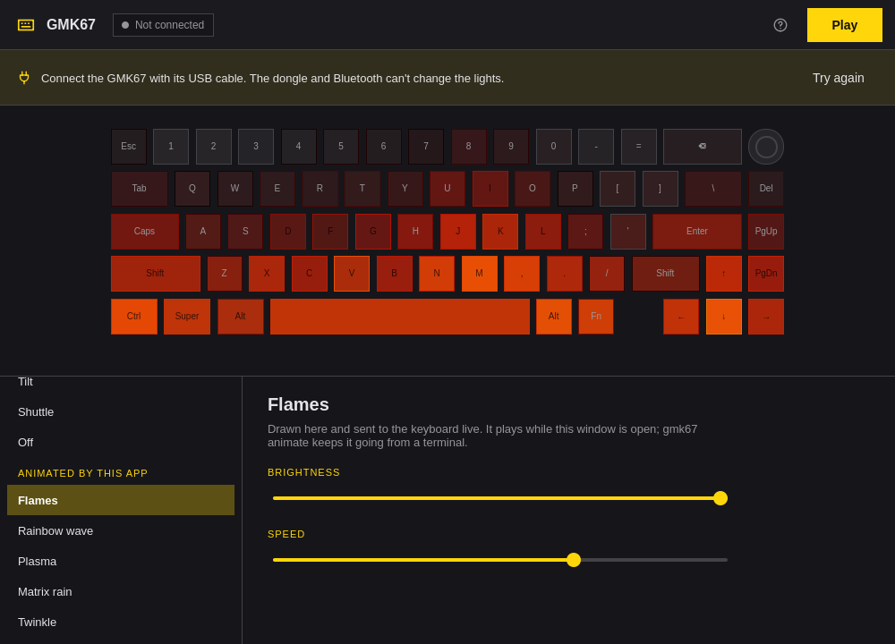

# GMK67

Lighting for the Zuoya GMK67 keyboard on [Omarchy](https://omarchy.org): the
keyboard's own 19 effects, plus effects it can't do by itself — flames, plasma,
a rainbow wave, Matrix rain, and twinkling stars — drawn on the PC and sent to
the keys live.



A C++/Qt rewrite of [aloran-dev/gmk67-rgb](https://github.com/aloran-dev/gmk67-rgb),
in the style of Omarchy's own apps: one window, driven from the keyboard,
following the theme's colors, rounding and language.

## Compatibility

Only the **GMK67 v1** connected **by USB cable**. The 2.4 GHz dongle and
Bluetooth don't carry the lighting commands. It identifies like this:

```
$ lsusb
... ID 05ac:024f Apple, Inc. Aluminium Keyboard (ANSI)   ← ID borrowed by the firmware
$ grep hfd /sys/class/hidraw/hidraw*/device/uevent
HID_NAME=hfd.cn USB DEVICE
```

The GMK67 **v2** (`36b0:3068`) runs QMK/VIA and works with [VIA](https://usevia.app).

## Install

From the [higorhgon arch-repo](https://github.com/higorhgon/arch-repo):

```sh
sudo pacman -S gmk67-git
```

The package installs a udev rule that lets the logged-in user use the keyboard;
unplug and replug the cable once after installing. Then open **GMK67** from the
launcher (`Super + Space`).

To build it yourself: `bin/build` (needs `qt6-base`, `qt6-declarative`, `qmake6`
and `make`), `bin/test` runs the tests, and `bin/install` builds and installs the
package with `makepkg`.

## Keyboard effects and animated effects

- **Keyboard effects** are saved on the keyboard. They keep running after you
  close the app or unplug the cable.
- **Animated effects** are drawn by this app, 60 frames a second, and play while
  it's open. Nothing is written to the keyboard's memory: when they stop, it goes
  back to its own effect after a few seconds. To keep one playing without the
  window, use `gmk67 animate` (below).

## Shortcuts

| Key | Action |
|---|---|
| `↑` / `↓`, `k` / `j` | Previous or next effect |
| `Space` / `Enter` | Apply the effect (play, for animated ones) |
| `Esc` | Stop the animation |
| `←` / `→` | Less or more brightness |
| `Shift + ←` / `Shift + →` | Slower or faster |
| `c` | Pick a color |
| `1` … `8` | Use a recent color |
| `r` | Random colors on or off |
| `?` / `F1` | Show the shortcuts |
| `q` | Quit |

## Command line

Every command works without a window, for scripts and agents. Errors go to
stderr and the exit code is 0 or 1.

```sh
gmk67 list [--json]                       # every effect; animated ones marked
gmk67 status [--json]                     # the keyboard and its current effect
gmk67 set wave --color '#ff8000' --speed 12 --direction right-left
gmk67 set breathing --random --brightness 8
gmk67 animate flames --speed 10           # plays until Ctrl+C or SIGTERM
```

`gmk67 animate` can run from Hyprland's autostart to keep an animation going
all the time:

```lua
-- ~/.config/hypr/autostart.lua
o.exec_on_start("gmk67 animate plasma --brightness 10")
```

## Protocol

64-byte HID feature reports with no report ID, on interface 0 of the wired
keyboard.

| Packets | Meaning |
|---|---|
| `04 18`, `04 13 … [8]=01`, page, `04 02`, `04 F0` | Save an effect. Each command is acknowledged with `04 <cmd> 00 01`. |
| `[mode, R, G, B, 0, 0, 0, 0, random, brightness+1, speed+1, direction, 0, 0, AA, 55]` | The effect page. Modes `0x01`–`0x13`; `0x00` is off. |
| `04 12 … [8]=01`, page, `04 02` | Read the saved effect. |
| `04 02`, `04 20 … [8]=08`, 8 pages | One live frame: `[light index, R, G, B]` for each of the 66 keys, in row order. Not saved. |

Live frames skip the firmware's color handling, so green needs much less power
there: the app corrects colors separately for effect pages and live frames.
Details are in [`src/protocol.cpp`](src/protocol.cpp) and
[`src/keyboard.cpp`](src/keyboard.cpp).

Never send `04 11` or `04 27`: they replace the base and Fn keymaps.

## Credits

- [aloran-dev/gmk67-rgb](https://github.com/aloran-dev/gmk67-rgb) (GPL-3.0), the
  original app and the effect protocol, taken from the official Windows driver.
- [yasasgit/gmk67-openrgb](https://github.com/yasasgit/gmk67-openrgb)'s
  `docs/PROTOCOL.md`: the live frame command and the keys' light indices.
- The theme and translation classes and the build scripts follow Omacut and
  Monologue, and the look of the controls follows Hype (MIT, David Heinemeier
  Hansson), by way of [Omajim](https://github.com/higorhgon/omajim).

## License

[GPL-3.0](LICENSE)
